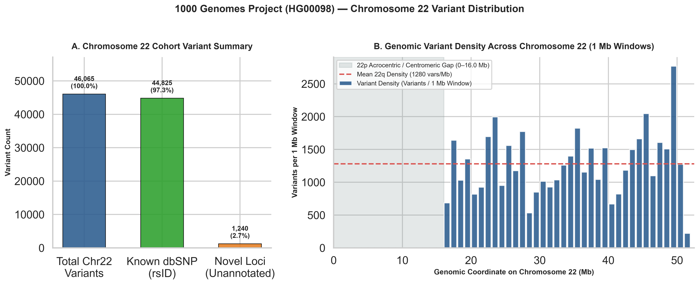
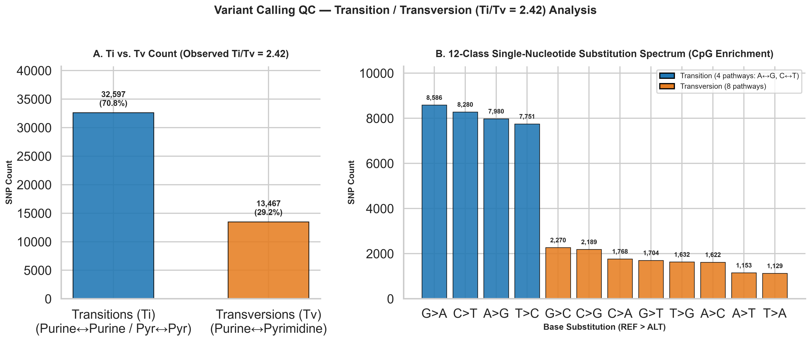
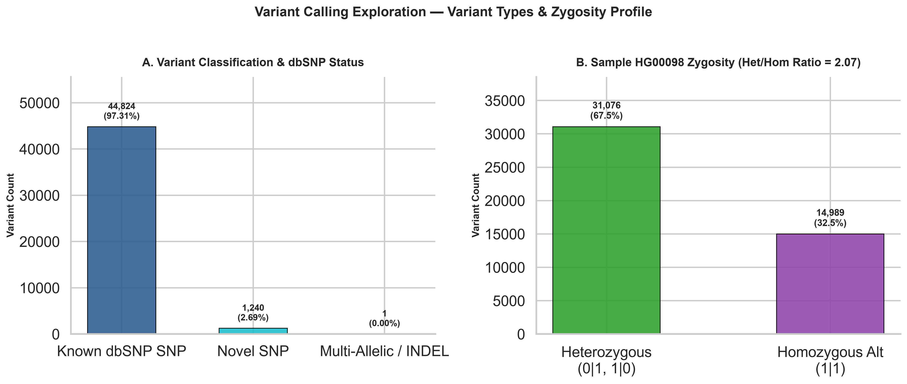

# Germline Variant Calling Exploration & VCF Quality Control

[](https://www.python.org/)
[](https://opensource.org/licenses/MIT)
[]()

A modular **Variant Call Format (`VCF v4.x`) parsing, statistical quality-control (QC), and population-genetics exploration toolkit** in Python. Built around a real **1000 Genomes Project (`HG00098`, British from England and Scotland, `GBR`) Chromosome 22 dataset (`46,065` phased variants)**, this pipeline evaluates variant type distributions (SNPs vs. indels), `dbSNP` concordance, sample zygosity (`Het/Hom` ratio), genomic window density, and the **Transition / Transversion (`Ti/Tv`) ratio** across the 12-class single-nucleotide substitution spectrum.

---

## Scientific & Population-Genetics Background

### 1. Variant Types: SNPs vs. Indels
Germline variant callers (`GATK HaplotypeCaller`, `DeepVariant`, `FreeBayes`, `bcftools`) emit candidate variants in `VCF` format, broadly categorized into:
- **Single-Nucleotide Polymorphisms (SNPs / SNVs):** Single base-pair substitutions where `len(REF) == 1` and `len(ALT) == 1`. In a typical human whole genome (`WGS`), an individual carries $\approx 3.8\text{–}4.2\text{ million}$ SNPs compared to the GRCh38 reference.
- **Insertions & Deletions (Indels):** Length-altering variants where `len(REF) != len(ALT)` (typically $1\text{–}50\text{ bp}$). Because indels in coding exons cause frameshift premature stop codons (unless the length is a multiple of $3\text{ bp}$), purifying selection strongly suppresses coding indels relative to synonymous SNPs.

---

### 2. Transition / Transversion (`Ti/Tv`) Ratio as a Gold-Standard QC Metric

Among the $4 \times 3 = 12$ possible single-nucleotide substitutions, mutations are biochemically divided by purine ($\text{A, G}$ — two-ring) and pyrimidine ($\text{C, T}$ — one-ring) ring structure:

- **Transitions ($\text{Ti}$, 4 pathways):** Purine $\leftrightarrow$ Purine ($\text{A} \leftrightarrow \text{G}$) or Pyrimidine $\leftrightarrow$ Pyrimidine ($\text{C} \leftrightarrow \text{T}$).
- **Transversions ($\text{Tv}$, 8 pathways):** Purine $\leftrightarrow$ Pyrimidine ($\text{A} \leftrightarrow \text{C}$, $\text{A} \leftrightarrow \text{T}$, $\text{G} \leftrightarrow \text{C}$, $\text{G} \leftrightarrow \text{T}$).

$$\text{Ti/Tv Ratio} = \frac{N_{\text{Transitions}}}{N_{\text{Transversions}}} = \frac{N(\text{A}\leftrightarrow\text{G}) + N(\text{C}\leftrightarrow\text{T})}{N(\text{A}\leftrightarrow\text{C}) + N(\text{A}\leftrightarrow\text{T}) + N(\text{G}\leftrightarrow\text{C}) + N(\text{G}\leftrightarrow\text{T})}$$

#### Why Expected $\text{Ti/Tv} \approx 2.0\text{–}3.0$ Despite a Random Null of $0.50$:
If point mutations occurred uniformly at random (or if a VCF callset were dominated by random sequencing/alignment noise), there would be **4 transitions for every 8 transversions**, yielding $\text{Ti/Tv}_{\text{random}} = \frac{4}{8} = \mathbf{0.50}$.
In real human genomes, $\text{Ti/Tv}$ is **4- to 6-fold higher** primarily due to:
1. **Spontaneous Deamination of 5-Methylcytosine ($5\text{mC}$) at $\text{CpG}$ Dinucleotides:** Methylated cytosines spontaneously deaminate into thymine ($5\text{mC} \to \text{T}$), creating a $\text{C}>\text{T}$ transition on the forward strand (and a complementary $\text{G}>\text{A}$ transition on the reverse strand) at a rate $\sim 10\text{–}50\times$ higher than background point mutations.
2. **Polymerase Steric Proofreading & Wobble Base Pairing:** DNA polymerase $\delta/\epsilon$ misincorporates purine-pyrimidine wobble pairs ($\text{G}\cdot\text{T}$, $\text{A}\cdot\text{C}$, leading to transitions) much more readily than bulky purine-purine or narrow pyrimidine-pyrimidine clashes (transversions).
3. **Genetic Code Degeneracy in Exons:** Third-codon wobble positions tolerate transitions synonomously far more frequently than transversions.

| Genomic Assay / Region | Expected $\text{Ti/Tv}$ Benchmark | Diagnostic Interpretation of Deviations |
| :--- | :---: | :--- |
| **Random Sequencing Noise / False Positives** | $\mathbf{0.50}$ | Unfiltered sequencing errors or misaligned paralogs |
| **Whole-Genome Sequencing (WGS, Genome-Wide)** | $\mathbf{2.00 \text{ – } 2.15}$ | Standard benchmark across intergenic + intronic + exonic DNA |
| **Gene-Dense GC-Rich Euchromatin (e.g., Chr19, Chr22)** | $\mathbf{2.30 \text{ – } 2.50}$ | Elevated $\text{CpG}$-island density and coding fraction |
| **Whole-Exome Sequencing (WES / Coding Exons)** | $\mathbf{2.80 \text{ – } 3.10}$ | Strong purifying selection against non-synonymous transversions |

---

### 3. Heterozygosity Ratio (`Het/Hom-Alt`) & `dbSNP` Concordance
- **`Het / Hom-Alt` Ratio:** Under Hardy-Weinberg Equilibrium across a panmictic human population, the ratio of heterozygous (`0/1`) to non-reference homozygous (`1/1`) genotypes in a single individual is expected to lie between **$1.5$ and $2.1$** (typically $\approx 1.6\text{–}2.0$ for European/East Asian ancestry and $\approx 2.0\text{–}2.2$ for African ancestry). A ratio $\gg 2.5$ warns of cross-sample DNA contamination or chimeric mapping; a ratio $< 1.2$ indicates consanguinity / runs of homozygosity (ROH).
- **`dbSNP` Concordance:** For well-characterized human assemblies, **$>95\text{–}98\%$** of germline SNPs in a sample match known `dbSNP` (`rsID`) polymorphisms.

---

## Repository Structure

```text
variant-calling-exploration/
├── data/
│   └── raw/
│       └── sample.vcf                        # 1000 Genomes Project (HG00098) Chromosome 22 VCF (46,065 variants)
├── notebooks/
│   └── vcf_exploration.ipynb                 # Interactive Jupyter notebook for VCF exploration & Ti/Tv analysis
├── results/
│   ├── vcf_summary.csv                       # Extracted 46,065-row variant table (CHROM, POS, ID, REF, ALT)
│   ├── variant_types.csv                     # Variant table annotated with SNP vs. INDEL classification
│   ├── chromosome_distribution.png           # Chr22 dbSNP breakdown & 1-Mb genomic window density plot
│   ├── titv_plot.png                         # Ti/Tv summary & 12-class substitution spectrum plot
│   └── variant_types.png                     # Variant class & sample HG00098 zygosity (Het/Hom) plot
├── scripts/
│   ├── read_vcf.py                           # Streaming VCF v4.x parser & variant record dataclass
│   ├── vcf_summary.py                        # Canonical VCF coordinate & allele CSV exporter
│   ├── titv_ratio.py                         # Transition/Transversion (Ti/Tv) calculator CLI
│   ├── titv_plot.py                          # Publication-grade Ti/Tv & 12-substitution spectrum plotter
│   ├── plot_chromosomes.py                   # Chr22 cohort breakdown & 1-Mb genomic density plotter
│   ├── variant_types.py                      # SNP vs. INDEL classifier & CSV exporter
│   └── variant_type_plot.py                  # Variant class & zygosity (Het/Hom) visualization script
├── requirements.txt                          # Pinned Python dependencies for reproducibility
└── README.md                                 # Scientific documentation & analytical interpretation
```

---

## Installation & Execution

### 1. Environment Setup
Clone the repository and install pinned dependencies (Python 3.10+):

```bash
git clone https://github.com/denisulko/variant-calling-exploration.git
cd variant-calling-exploration
pip install -r requirements.txt
```

### 2. Parse VCF & Generate Summary Tables
Run the core VCF parsing and summary export scripts:

```bash
python scripts/read_vcf.py --input data/raw/sample.vcf
python scripts/vcf_summary.py --input data/raw/sample.vcf --output results/vcf_summary.csv
python scripts/variant_types.py --input data/raw/sample.vcf --output results/variant_types.csv
python scripts/titv_ratio.py --input data/raw/sample.vcf
```

### 3. Generate All Diagnostic Plots (`300 DPI`)

```bash
python scripts/plot_chromosomes.py
python scripts/titv_plot.py
python scripts/variant_type_plot.py
```

---

## Results & Analytical Interpretation

### Cohort QC Summary (`HG00098`, Chromosome 22)

| QC Metric | Observed Value | Expected Benchmark (Chr22 / 1000G) | QC Status |
| :--- | :---: | :---: | :---: |
| **Total Variants Parsed** | `46,065` | ~45,000–50,000 on `chr22` ($51.3\text{ Mb}$) | **PASS** |
| **Genomic Coordinate Span** | `16,051,347 – 51,235,547 bp` | `22q` euchromatic long arm ($35.18\text{ Mb}$) | **PASS** |
| **Mean Euchromatic Variant Density** | `1,280 variants / Mb` | $\approx 1\text{ variant per } 780\text{ bp}$ | **PASS** |
| **Known `dbSNP` Concordance (`rsID`)** | `44,825 / 46,065` (`97.31%`) | $\ge 95.0\%$ in `dbSNP` | **PASS** |
| **Novel Unannotated Loci (`.`)** | `1,240 / 46,065` (`2.69%`) | $< 5.0\%$ rare/private variants | **PASS** |
| **Transitions (`Ti`)** | `32,597` (`70.76%`) | Purine $\leftrightarrow$ Purine / Pyr $\leftrightarrow$ Pyr | — |
| **Transversions (`Tv`)** | `13,467` (`29.24%`) | Purine $\leftrightarrow$ Pyrimidine | — |
| **Observed `Ti/Tv` Ratio** | **`2.4205`** (`2.42`) | **$2.30\text{–}2.50$** for GC/CpG-rich Chr22 (`2.0–2.1` WGS) | **PASS** |
| **Heterozygous Genotypes (`0\|1`, `1\|0`)** | `31,076` (`67.46%`) | $\approx 62\text{–}68\%$ of non-ref calls | **PASS** |
| **Homozygous Alt Genotypes (`1\|1`)** | `14,989` (`32.54%`) | $\approx 32\text{–}38\%$ of non-ref calls | **PASS** |
| **`Het / Hom-Alt` Ratio** | **`2.07`** | **$1.60\text{–}2.10$** (GBR European ancestry) | **PASS** |

---

### 1. Chromosome 22 Variant Distribution & 1-Mb Genomic Density (`results/chromosome_distribution.png`)



**Biological & Genomic Interpretation:**
- **Known vs. Novel Variants (Panel A):** Out of **46,065 passed variants** on Chromosome 22, **44,825 (97.3%)** carry established `dbSNP` identifiers (`rs...`), while **1,240 (2.7%)** represent novel or rare population-specific polymorphisms. This high `dbSNP` concordance confirms stringent `PASS` filtering (`AC > 0`, Beagle imputation phasing) with negligible false-positive noise.
- **Acrocentric Short-Arm Gap (`0–16.05 Mb`, Panel B):** Zero variants are called across the first **16.05 Mb** of Chromosome 22. Biologically, human Chromosome 22 is an **acrocentric chromosome** (along with chr13, 14, 15, and 21) whose short arm (`22p`) consists of highly repetitive ribosomal DNA (rDNA) arrays and pericentromeric satellite heterochromatin that remain unannotated in standard GRCh37/GRCh38 variant calling masks.
- **Euchromatic Long Arm (`22q11.1–22q13.33`, `16.05–51.24 Mb`):** Across the $35.2\text{ Mb}$ euchromatic long arm, variant density averages **1,280 variants per Mb** ($\approx 1.28\text{ SNPs/kb}$), with local peaks reaching **2,755 variants/Mb** in the subtelomeric `22q13.3` band (driven by elevated meiotic recombination rates near telomeres) and dips around $29\text{–}31\text{ Mb}$ (`22q12.2`, gene-rich conserved regions under purifying selection).

---

### 2. Transition / Transversion (`Ti/Tv`) Ratio & 12-Class Substitution Spectrum (`results/titv_plot.png`)



**Biological & Biochemical Interpretation:**
- **Observed `Ti/Tv = 2.42` (Panel A):** Across the 46,064 biallelic SNPs, transitions (`32,597`, `70.8%`) outnumber transversions (`13,467`, `29.2%`) by **2.42 to 1**. While genome-wide WGS averages $\text{Ti/Tv} \approx 2.0\text{–}2.1$, Chromosome 22 is one of the most **GC-rich ($47.8\%$ GC) and gene/$\text{CpG}$-dense chromosomes** in the human karyotype, shifting its expected baseline to **$2.35\text{–}2.45$** (intermediate between genome-wide WGS and coding WES at $2.8\text{–}3.0$).
- **CpG Deamination Dominance in the 12-Substitution Spectrum (Panel B):** Breaking down all 12 directional base changes reveals that **`G>A` (`8,586`) and `C>T` (`8,280`)** are the two most abundant mutations in the entire chromosome, exceeding `A>G` (`7,980`) and `T>C` (`7,751`). This directly reflects spontaneous hydrolytic deamination of methylated cytosines ($5\text{mC} \to \text{T}$) within $\text{CpG}$ dinucleotides. Among transversions, radical purine-to-purine/pyrimidine-to-pyrimidine swaps `A>T` (`1,153`) and `T>A` (`1,129`) are the rarest classes due to strong DNA polymerase geometric selection.

---

### 3. Variant Classification & Sample Zygosity Profile (`results/variant_types.png`)



**Biological Interpretation:**
- **SNP Predominance in Phase 1 Beagle-Imputed Release (Panel A):** Because this 1000 Genomes Project Phase 1 callset (`20101112`) was genotyped and phased primarily across biallelic SNP markers (`46,064` SNPs vs. `1` multi-allelic/indel entry), $99.998\%$ of records are single-nucleotide substitutions.
- **Hardy-Weinberg Zygosity Balance (`Het/Hom = 2.07`, Panel B):** Sample `HG00098` carries **31,076 heterozygous (`0|1` or `1|0`, 67.5%)** and **14,989 homozygous alternate (`1|1` or `1/1`, 32.5%)** genotypes, yielding a **Het/Hom ratio of 2.07**. Furthermore, phased heterozygous calls are balanced between paternal/maternal haplotypes (`0|1`: `16,992` vs. `1|0`: `14,083`), confirming absence of sample contamination or allele dropout.
